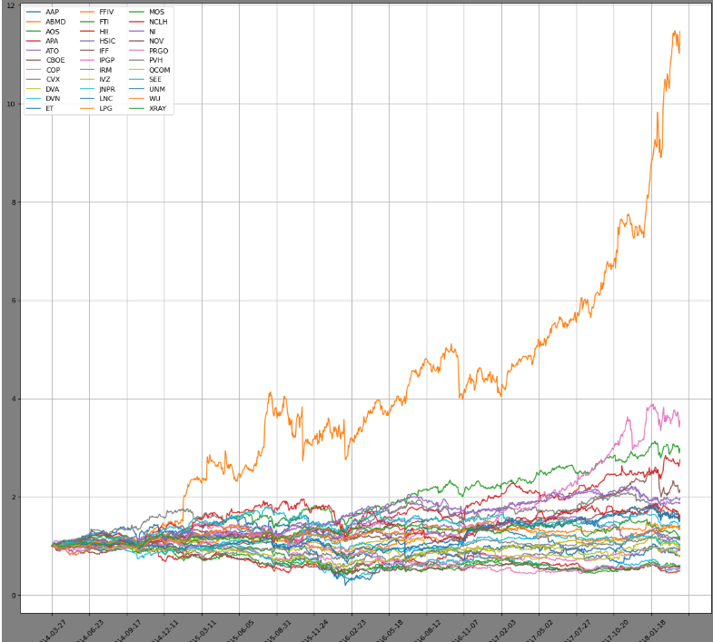
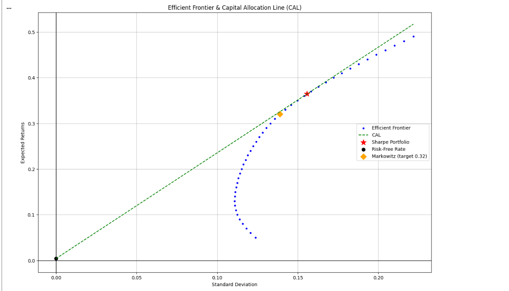
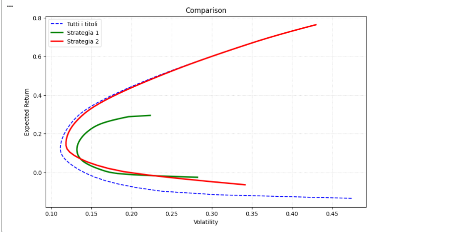

Il progetto include l'implementazione del modello di **Portafoglio di Markowitz**, il calcolo e la tracciatura della **Capital Allocation Line (CAL)** con risk-free rate, l'individuazione del **Portafoglio di Sharpe**, e l'applicazione di un **Modello Multi-Fattoriale (S&P 500 e Brent)** per la selezione ottima di titoli azionari.

---

## 📌 Obiettivi del Progetto

1. **Analisi di Markowitz**:
   - Calcolo della **Frontiera Efficiente** per asset rischiosi.
   - Individuazione del portafoglio ottimo per un **rendimento atteso annuo del 32% ($\mu = 0.32$)**.
   - Integrazione del proxy del tasso privo di rischio ($r_f$, *Treasury a 3 mesi*) per calcolare la **Capital Allocation Line (CAL)** e individuare il **Portafoglio di Sharpe** (Tangency Portfolio).

2. **Modello a Due Fattori (S&P 500 & Brent)**:
   - Valutazione dell'impatto dei fattori di mercato (**S&P 500**) e delle materie prime (**Brent Oil**) sulle serie storiche dei titoli.
   - Selezione motivata dei **10 migliori titoli** su cui investire in uno scenario di **improvviso calo del prezzo del petrolio**, integrando analisi settoriale tramite il modulo `yfinance`.

---

## 📁 Struttura della Repository

| File / Risorsa | Descrizione |
| :--- | :--- |
| `mark_sim.csv` | Dataset storico contenente i prezzi di chiusura dei titoli, dell'S&P 500, del prezzo del Brent e del rendimento dei Treasury a 3 mesi ($r_f$). |
| `cal_marko.png` | Grafico della **Frontiera Efficiente**, del **Portafoglio di Sharpe** e della **Capital Allocation Line (CAL)**. |
| `compariso.png` | Grafico comparativo delle performance e dei pesi dei portafogli. |
| `graphs.png` | Output visivo generale e regressioni dei fattori. |
| `notebook.ipynb` *(o script `.py`)* | Notebook/Script contenente tutto il codice di calcolo e le analisi finanziarie. |

---

## 📊 Visualizzazioni e Risultati

### 1. Rendimento dei Titoli Normalizzati
Andamento storico normalizzato ($P_t / P_0$) dell'universo dei titoli presi in esame:



### 2. Frontiera Efficiente & Capital Allocation Line (CAL)
Tracciamento della frontiera efficiente dei soli asset rischiosi, con l'evidenziazione del portafoglio con target return al 32%, del tasso privo di rischio ($r_f$ dai Treasury a 3 mesi) e del portafoglio di Sharpe ottimale:



### 3. Confronto delle Performance
Grafico delle allocazioni dei pesi e confronto dei rendimenti/rischio tra i diversi portafogli calcolati:



---

## 🚀 Requisiti e Installazione

Per eseguire il codice Python utilizzato in questa repository, installare le librerie necessarie:

```bash
pip install numpy pandas matplotlib seaborn statsmodels yfinance
